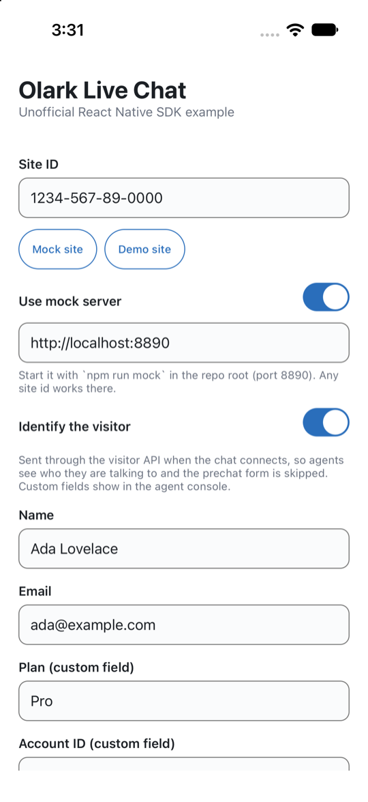
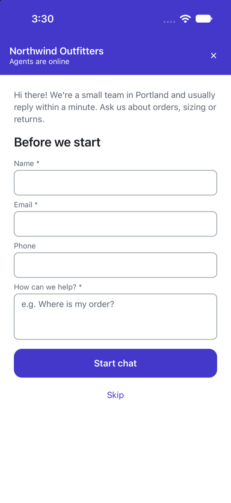
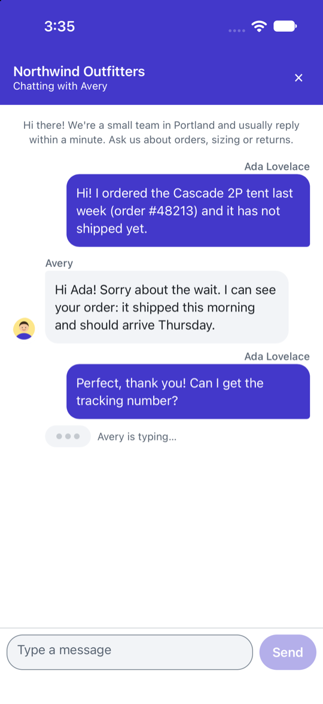
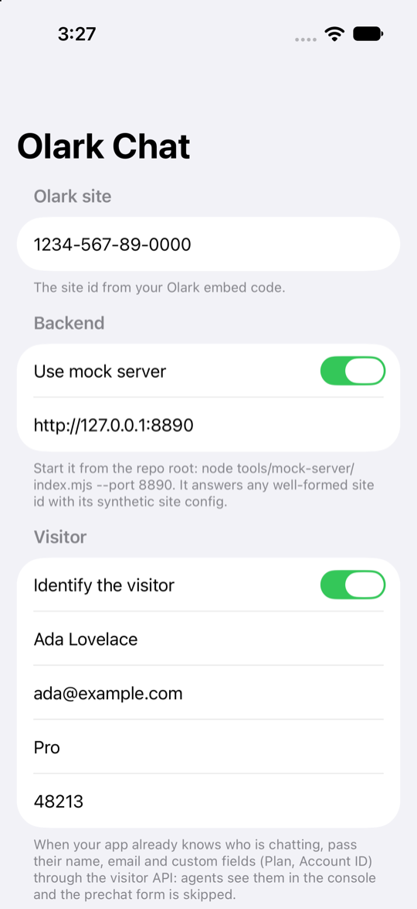
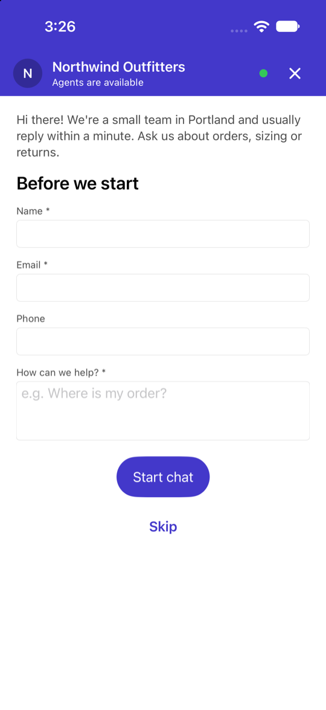
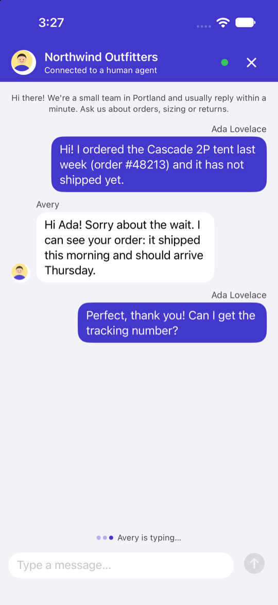

# Unofficial Olark SDKs for React Native and Swift

> **Unofficial and unsupported.** This project is not affiliated with, endorsed by, or supported by Olark.
> It is a community beta built by observing what Olark's public chatbox JavaScript does on the wire, and it
> can stop working at any time if Olark changes that behaviour. Do not contact Olark support about it; use the
> [issue tracker](https://github.com/jaminben/unofficial-olark-react-native/issues) instead. Use at your own risk.

**Full repository coming soon.** The code is being cleaned up for release; this README and the screenshots are
here so the repository is not empty in the meantime.

Visitor-side SDKs for [Olark](https://www.olark.com) live chat: a headless TypeScript client, a React Native
hook with a drop-in `OlarkChatView`, and a native Swift package (`OlarkLiveChat` + SwiftUI `OlarkLiveChatUI`).
Messages to and from agents, typing indicators, agent presence, prechat forms that follow the site's survey (full
screen or inline), visitors your app already knows (name, email and custom fields passed in, no prechat), offline
messages, background refresh with local notifications, and accessibility that follows the web chatbox's model.

| Package | What | Status |
|---|---|---|
| `olark-live-chat-core` | Headless TypeScript client (Node, web, React Native) | coming soon |
| `olark-live-chat-react-native` | React Native hook + drop-in `OlarkChatView` (pure TS, Expo Go compatible) | coming soon |
| `olark-live-chat-swift` | SwiftPM `OlarkLiveChat` + SwiftUI `OlarkLiveChatUI` (iOS 16+, macOS 13+) | coming soon |
| `olark-ai` / Swift `OlarkAI` | Olark AI SDK | placeholder |

  
  
  

  
  
  

*Top: the React Native (Expo) example; bottom: the SwiftUI example. Both against the bundled mock server's demo site:
settings with an identified visitor, the full-screen prechat survey an anonymous visitor sees, and a conversation.*

## Disclaimer

- **Unofficial.** This is an independent, community project. It is not an Olark product and is not affiliated
  with, endorsed by, or supported by Olark. "Olark" is a trademark of its owner; it is used here only to describe
  what the packages talk to.
- **Unsupported.** There is no SLA, no support channel at Olark, and no guarantee of fixes. Olark support cannot
  help with this code. Report problems on the issue tracker, and expect best-effort, volunteer responses.
- **Beta, and built on unpublished behaviour.** The packages speak the protocol Olark's public chatbox uses in the
  browser. Olark does not publish or commit to that protocol and may change it without notice, which can break
  these SDKs at any time, in any version.
- **Your responsibility.** Using these packages against an Olark account is subject to Olark's terms of service.
  Make sure your use is allowed under your agreement with Olark before shipping anything built on them.
- **No warranty.** Provided "as is", without warranty of any kind, under the MIT license.

## License

MIT.
